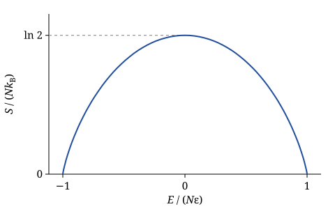
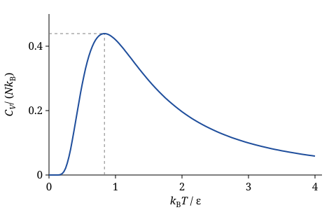

# Zadanie 1. Układ dwustanowy

## Treść

Rozważ układ $N$ nieoddziałujących cząstek o spinie $1/2$ w jednorodnym polu magnetycznym $B$. Każda cząstka może zajmować jeden z dwóch poziomów energetycznych:

```
energia cząstki

    ──────────────   +ε
    ──────────────   −ε
```

Układ jest izolowany. Jego stan makroskopowy określają całkowita energia $E$ i liczba cząstek $N$.

Wyprowadź następujące wielkości fizyczne:

- (a) liczbę mikrostanów $\Omega(E,N)$,
- (b) temperaturę $T$,
- (c) energię jako funkcję temperatury, $E(T)$,
- (d) entropię $S(E,N)$; naszkicuj wykres $S(E)$ i znajdź maksimum entropii,
- (e) pojemność cieplną $C_V(T)$; naszkicuj jej wykres.

## Wskazówki

**(a) Liczba mikrostanów.**

- Oznacz przez $N_+$ i $N_-$ liczby cząstek na poziomach $+\varepsilon$ i $-\varepsilon$. Wyraź je przez $E$ i $N$.
- Na ile sposobów można wybrać $N_+$ cząstek spośród $N$?

**(b) Temperatura.**

- $1/T = (\partial S/\partial E)_N$, gdzie $S = k_B\ln\Omega$.
- Uprość $\ln\Omega$ wzorem Stirlinga, $\ln n! \approx n\ln n - n$.
- Wynik najprościej zapisać przez stosunek obsadzeń $N_-/N_+$.

**(c) Energia jako funkcja temperatury.**

- Z wyniku punktu (b) wyznacz $N_+(T)$ i $N_-(T)$.

**(d) Entropia.**

- Oblicz $\partial S/\partial E$, żeby znaleźć maksimum entropii.
- Dla skrajnych energii $E = \pm N\varepsilon$ skorzystaj z $\lim_{n\to 0} n\ln n = 0$.

**(e) Pojemność cieplna.**

- Zróżniczkuj $E(T)$ z punktu (c) przy stałym $\varepsilon$.
- Do szkicu wykresu: do czego dąży $C_V$ dla $k_BT \ll \varepsilon$ i dla $k_BT \gg \varepsilon$?

## Rozwiązanie

### (a) Liczba mikrostanów

Oznaczmy przez $N_+$ liczbę cząstek na poziomie $+\varepsilon$, a przez $N_-$ liczbę cząstek na poziomie $-\varepsilon$. Całkowita liczba cząstek i całkowita energia wynoszą

$$
N = N_+ + N_-, \qquad E = N_+\varepsilon + N_-(-\varepsilon) = (N_+ - N_-)\,\varepsilon .
$$

Z tych dwóch równań wyznaczamy $N_+$ i $N_-$ jako funkcje $E$ i $N$:

$$
N_+ = \frac{1}{2}\left(N + \frac{E}{\varepsilon}\right), \qquad
N_- = \frac{1}{2}\left(N - \frac{E}{\varepsilon}\right).
$$

Cząstki są rozróżnialne (np. spiny w węzłach sieci krystalicznej). Mikrostan określa więc, które cząstki zajmują wyższy poziom. Liczba mikrostanów to liczba sposobów wyboru $N_+$ cząstek spośród $N$:

$$
\Omega(E,N) = \binom{N}{N_+} = \frac{N!}{N_+!\,(N-N_+)!} = \frac{N!}{N_+!\,N_-!} .
$$

### (b) Temperatura

Entropia układu izolowanego wynosi $S = k_B\ln\Omega$, a temperaturę definiuje równanie

$$
\frac{1}{T} = \left(\frac{\partial S}{\partial E}\right)_N
\quad\Longrightarrow\quad
\frac{1}{k_B T} = \frac{\partial \ln\Omega(E,N)}{\partial E} .
$$

Dla dużych liczb stosujemy wzór Stirlinga, $\ln n! \approx n\ln n - n$:

$$
\ln\Omega = \ln N! - \ln N_+! - \ln N_-!
\approx N\ln N - N - N_+\ln N_+ + N_+ - N_-\ln N_- + N_- .
$$

Wyrazy liniowe się znoszą, bo $N_+ + N_- = N$:

$$
\ln\Omega = N\ln N - N_+\ln N_+ - N_-\ln N_- .
$$

$\ln\Omega$ zależy od $E$ przez $N_+$ i $N_-$. Z reguły łańcuchowej

$$
\frac{\partial\ln\Omega}{\partial E}
= \frac{\partial\ln\Omega}{\partial N_+}\,\frac{\partial N_+}{\partial E}
+ \frac{\partial\ln\Omega}{\partial N_-}\,\frac{\partial N_-}{\partial E},
$$

gdzie

$$
\frac{\partial\ln\Omega}{\partial N_+} = -\ln N_+ - 1, \qquad
\frac{\partial\ln\Omega}{\partial N_-} = -\ln N_- - 1, \qquad
\frac{\partial N_+}{\partial E} = \frac{1}{2\varepsilon}, \qquad
\frac{\partial N_-}{\partial E} = -\frac{1}{2\varepsilon} .
$$

Po podstawieniu

$$
\frac{1}{k_B T}
= \frac{1}{2\varepsilon}\left(-\ln N_+ - 1 + \ln N_- + 1\right)
= \frac{1}{2\varepsilon}\ln\frac{N_-}{N_+} .
$$

Zatem stosunek obsadzeń poziomów wynosi

$$
\frac{N_-}{N_+} = \exp\left(\frac{2\varepsilon}{k_B T}\right).
$$

### (c) Energia jako funkcja temperatury

Najpierw wyznaczamy $N_+$ i $N_-$ jako funkcje temperatury. Z układu równań

$$
N_- = N_+\exp\left(\frac{2\varepsilon}{k_B T}\right), \qquad N = N_+ + N_-
$$

dostajemy $N = N_+\left(1 + e^{2\varepsilon/k_BT}\right)$, czyli

$$
N_+ = \frac{N}{1 + e^{2\varepsilon/k_BT}}, \qquad
N_- = N - N_+ = N\,\frac{e^{2\varepsilon/k_BT}}{1 + e^{2\varepsilon/k_BT}} .
$$

Całkowita energia jako funkcja temperatury:

$$
E(T) = \big(N_+(T) - N_-(T)\big)\,\varepsilon
= N\varepsilon\,\frac{1 - e^{2\varepsilon/k_BT}}{1 + e^{2\varepsilon/k_BT}}
= -N\varepsilon\tanh\frac{\varepsilon}{k_BT} .
$$

Ułamki obsadzeń mają postać rozkładu Boltzmanna:

$$
\frac{N_\pm}{N} = \frac{e^{\mp\varepsilon/k_BT}}{e^{\varepsilon/k_BT} + e^{-\varepsilon/k_BT}} .
$$

Przypadki graniczne:

- $T \to 0$: $E \to -N\varepsilon$. Wszystkie cząstki zajmują niższy poziom.
- $T \to \infty$: $E \to 0$. Oba poziomy są obsadzone jednakowo, $N_+ = N_- = N/2$.

### (d) Entropia

Entropia jako funkcja $E$ i $N$:

$$
S(E,N) = k_B\ln\Omega = k_B\left(N\ln N - N_+\ln N_+ - N_-\ln N_-\right)
$$

$$
= k_B\left[N\ln N - \frac{1}{2}\left(N + \frac{E}{\varepsilon}\right)\ln\left(\frac{1}{2}\left(N + \frac{E}{\varepsilon}\right)\right)
- \frac{1}{2}\left(N - \frac{E}{\varepsilon}\right)\ln\left(\frac{1}{2}\left(N - \frac{E}{\varepsilon}\right)\right)\right].
$$

Wygodnie jest wprowadzić $x = E/(N\varepsilon)$, gdzie $-1 \le x \le 1$:

$$
\frac{S}{Nk_B} = -\frac{1+x}{2}\ln\frac{1+x}{2} - \frac{1-x}{2}\ln\frac{1-x}{2} .
$$

**Energia maksymalna.** Dla $E_{\max} = N\varepsilon$ wszystkie cząstki zajmują wyższy poziom:

$$
\frac{1}{2}\left(N + \frac{E_{\max}}{\varepsilon}\right) = N, \qquad
\frac{1}{2}\left(N - \frac{E_{\max}}{\varepsilon}\right) = 0 .
$$

Ponieważ $\lim_{n\to 0} n\ln n = 0$, ostatni wyraz w $S(E,N)$ znika:

$$
S(E_{\max}) = k_B\left(N\ln N - N\ln N\right) = 0 .
$$

**Energia minimalna.** Analogicznie, dla $E_{\min} = -N\varepsilon$ dostajemy $S(E_{\min}) = 0$.

Oba wyniki są dokładne: w każdym z tych stanów $\Omega = 1$.

**Maksimum entropii.** Warunek konieczny to

$$
\frac{\partial S(E,N)}{\partial E} = \frac{k_B}{2\varepsilon}\ln\frac{N_-}{N_+} = 0 .
$$

Spełnia go stan $N_+ = N_- = N/2$, czyli $E = 0$. Druga pochodna jest ujemna,

$$
\frac{\partial^2 S}{\partial E^2} = -\frac{k_B}{4\varepsilon^2}\left(\frac{1}{N_+} + \frac{1}{N_-}\right) < 0,
$$

więc jest to maksimum:

$$
S_{\max} = k_B\left(N\ln N - \frac{N}{2}\ln\frac{N}{2} - \frac{N}{2}\ln\frac{N}{2}\right) = Nk_B\ln 2 .
$$

Stan o maksymalnej entropii, $E = 0$, to granica $T \to \infty$ z punktu (c).



### (e) Pojemność cieplna

Pojemność cieplną liczymy przy stałym $N$ i stałym polu $B$, czyli przy stałym $\varepsilon$. Różniczkujemy $E(T)$ z punktu (c):

$$
C_V = \left(\frac{\partial E}{\partial T}\right)_N
= -N\varepsilon\,\frac{1}{\cosh^2(\varepsilon/k_BT)}\cdot\left(-\frac{\varepsilon}{k_BT^2}\right)
= Nk_B\left(\frac{\varepsilon}{k_BT}\right)^2\frac{1}{\cosh^2(\varepsilon/k_BT)} .
$$

Przypadki graniczne:

- $k_BT \ll \varepsilon$: $\cosh^2 y \approx e^{2y}/4$, więc $C_V \approx 4Nk_B\left(\varepsilon/k_BT\right)^2 e^{-2\varepsilon/k_BT}$. Pojemność cieplna zanika wykładniczo. Wzbudzenie cząstki wymaga energii $2\varepsilon$, a przy niskiej temperaturze jest to mało prawdopodobne.
- $k_BT \gg \varepsilon$: $\cosh^2 y \approx 1$, więc $C_V \approx Nk_B\left(\varepsilon/k_BT\right)^2 \to 0$. Obsadzenia są już prawie równe. Dalsze ogrzewanie prawie nie zmienia energii.

Pomiędzy tymi granicami $C_V$ ma maksimum. Dla $y = \varepsilon/k_BT$ mamy $C_V/(Nk_B) = y^2/\cosh^2 y$. Warunek $\mathrm{d}C_V/\mathrm{d}y = 0$ prowadzi do równania

$$
y\tanh y = 1 ,
$$

którego rozwiązanie numeryczne to $y \approx 1.200$. Maksimum leży więc w $k_BT \approx 0.834\,\varepsilon$ i wynosi $C_V \approx 0.439\,Nk_B$. Takie maksimum pojemności cieplnej nazywamy anomalią Schottky'ego. Występuje ono w każdym układzie o skończonej liczbie poziomów energetycznych.


